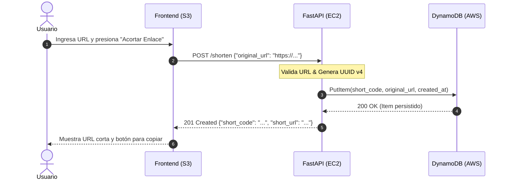
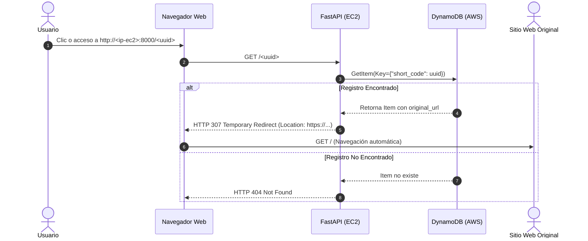
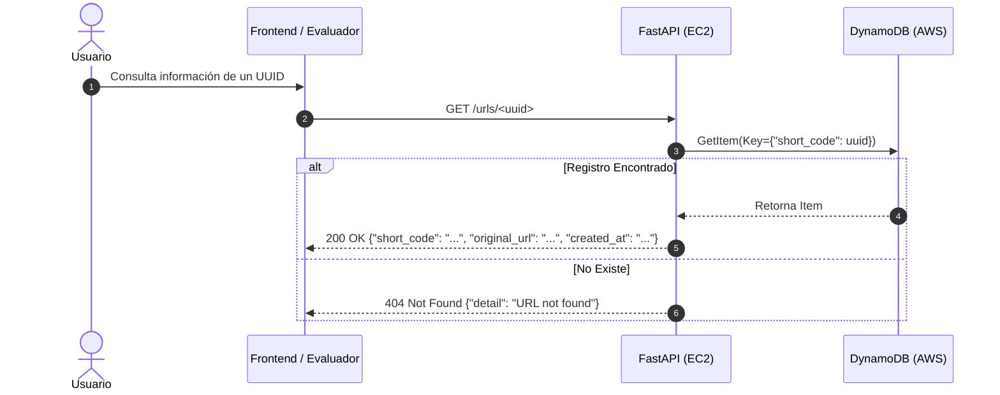

# Arquitectura del Acortador de Enlaces Cloud (AWS)

Este documento detalla la arquitectura de la solución, el flujo de datos entre los componentes y las directrices de seguridad implementadas según los requerimientos del examen parcial.

---

## 1. Diagrama de Arquitectura Global

La solución se compone de tres servicios fundamentales de AWS interconectados de manera segura y desacoplada:

```mermaid
graph TD
    User([👤 Usuario / Navegador])
    
    subgraph S3_Layer ["1. Capa de Presentación (Amazon S3)"]
        S3Bucket["📦 Bucket S3 (Static Website Hosting)\n- index.html\n- style.css\n- app.js\n- config.js"]
    end

    subgraph EC2_Layer ["2. Capa de Aplicación (Amazon EC2)"]
        SecGroup["🛡️ Security Group\nInbound: 8000 (0.0.0.0/0), 22 (SSH)"]
        FastAPIApp["⚡ FastAPI API REST (Uvicorn)\n- POST /shorten\n- GET /{short_code}\n- GET /urls/{short_code}\n- GET /health"]
        Systemd["⚙️ Servicio systemd\nurl-shortener.service (Auto-restart)"]
        IAMRole["🔑 Rol IAM EC2\nPermisos mínimos DynamoDB (Sin claves fijas)"]
    end

    subgraph DynamoDB_Layer ["3. Capa de Persistencia (Amazon DynamoDB)"]
        DDBTable["🗄️ Tabla DynamoDB: url_shortener\nPartition Key: short_code (String UUID)"]
    end

    %% Relaciones
    User -->|1. Carga interfaz HTML/CSS/JS| S3Bucket
    User -->|2. fetch() POST /shorten o GET| FastAPIApp
    FastAPIApp -.->|Gestionado por| Systemd
    FastAPIApp -.->|Asume credenciales de| IAMRole
    IAMRole -->|Acceso temporal autorizado| DDBTable
    FastAPIApp -->|PutItem / GetItem| DDBTable
    FastAPIApp -->|3. HTTP 307 Redirect| User
```

---

## 2. Descripción de Componentes

### 2.1 Amazon S3 (Capa de Presentación)
- **Función:** Servir los archivos estáticos de la interfaz web (`index.html`, `style.css`, `app.js`, `config.js`).
- **Mecanismo:** Amazon S3 Static Website Hosting.
- **Ventaja:** Alta disponibilidad, latencia mínima, sin costo de cómputo para servir assets estáticos y desacoplamiento total del backend.
- **Seguridad:** Bucket Policy de solo lectura pública (`s3:GetObject`) sin necesidad de permitir escritura ni acceso a la configuración del bucket.

### 2.2 Amazon EC2 (Capa de Lógica y Redirección)
- **Función:** Ejecutar la API REST desarrollada con **FastAPI** y servida mediante **Uvicorn**.
- **Gestión:** Administrada como un servicio del sistema mediante **systemd** (`url-shortener.service`), garantizando inicio automático tras reinicios del servidor y recuperación ante fallos.
- **Responsabilidades:**
  1. Validar la URL recibida del cliente.
  2. Generar el identificador único mediante **UUID versión 4** (`uuid.uuid4()`).
  3. Almacenar el registro en DynamoDB mediante **Boto3**.
  4. Responder con la URL corta.
  5. Ejecutar la redirección HTTP real (**HTTP 307 Temporary Redirect**) al consultar un enlace corto.
  6. Proveer el endpoint de inspección en formato JSON (**HTTP 200** / **HTTP 404**).

### 2.3 Amazon DynamoDB (Capa de Persistencia NoSQL)
- **Nombre de Tabla:** `url_shortener`
- **Clave de Partición (Partition Key):** `short_code` (Tipo: String).
- **Atributos de cada Elemento:**
  - `short_code` (String): Identificador único UUID v4.
  - `original_url` (String): Dirección web original de destino.
  - `created_at` (String): Marca de tiempo en formato ISO 8601 UTC (ej. `2026-10-29T21:40:00Z`).
- **Ventaja:** Rendimiento predecible con latencias de un solo dígito de milisegundo a cualquier escala, completamente administrado y sin servidor de base de datos que mantener.

---

## 3. Flujos de Datos Detallados

### 3.1 Flujo de Acortamiento (POST /shorten)



### 3.2 Flujo de Redirección (GET /{short_code})



### 3.3 Flujo de Consulta de Metadatos (GET /urls/{short_code})



---

## 4. Modelo de Seguridad y Buenas Prácticas

1. **Principio de Mínimo Privilegio (IAM Role):**
   - La instancia EC2 tiene asociado un **IAM Instance Profile** con una política que **únicamente** autoriza:
     - `dynamodb:PutItem`
     - `dynamodb:GetItem`
     - `dynamodb:DescribeTable`
   - **Cero credenciales estáticas:** No se utilizan `AWS_ACCESS_KEY_ID` ni `AWS_SECRET_ACCESS_KEY` codificadas en el repositorio o en archivos de texto plano. Boto3 obtiene tokens temporales automáticamente vía IMDSv2.

2. **Seguridad de Red (Security Groups):**
   - Puerto `8000` (TCP): Abierto a `0.0.0.0/0` para permitir llamadas HTTP desde la web y navegadores.
   - Puerto `22` (SSH): Restringido a la IP del administrador para tareas de mantenimiento.

3. **Control de Acceso Cruzado (CORS):**
   - El backend en FastAPI tiene configurado el middleware `CORSMiddleware` para autorizar las solicitudes de origen cruzado originadas desde el dominio S3 del frontend.
